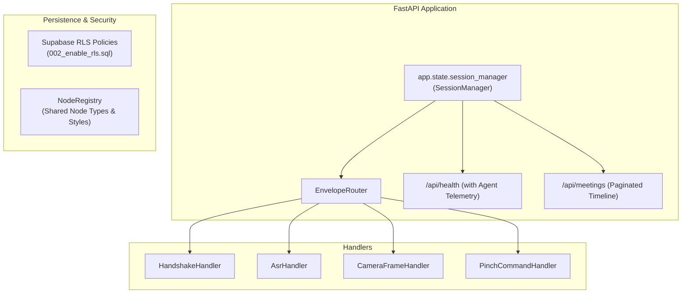

# Technical Specification Document: Code Audit Hardening & Remediation

**Document ID:** `SPEC-2026-10-19-AUDIT-HARDENING`  
**Repository:** [SpecScribe AR](file:///c:/Users/ruanc/source/repos/SpecScribe)  
**Author:** Antigravity Engineering Agent  
**Target Date:** 2026-10-19  
**Status:** Approved for Implementation (`/task-init` ready)  

---

## 1. Context & References

This specification compiles the technical design, architectural patterns, and execution requirements to resolve the remaining findings documented in the application code audit:

- **Source Audit:** [`CODE_AUDIT.md`](file:///c:/Users/ruanc/source/repos/SpecScribe/CODE_AUDIT.md) — 15 findings total (5 resolved: #1, #2, #3, #5, #6; 10 remaining: #4, #7, #8, #9, #10, #11, #12, #13, #14, #15).
- **Core PRD & Architecture Spec:** [`PRD.md`](file:///c:/Users/ruanc/source/repos/SpecScribe/PRD.md) and [`docs/spec.md`](file:///c:/Users/ruanc/source/repos/SpecScribe/docs/spec.md).
- **Prior Review Baseline:** [`docs/reviews/2026-10-17-full-app-review.md`](file:///c:/Users/ruanc/source/repos/SpecScribe/docs/reviews/2026-10-17-full-app-review.md).
- **Database Schema:** [`supabase/migrations/001_initial_schema.sql`](file:///c:/Users/ruanc/source/repos/SpecScribe/supabase/migrations/001_initial_schema.sql).

---

## 2. Completeness Rubric Assessment

Before drafting, the context was evaluated against the 4-part completeness rubric:

| Rubric Criterion | Status | Evaluation |
| :--- | :---: | :--- |
| **1. Clear Goal / Outcome** | **PASS** | Complete resolution and test-backed verification of all 10 remaining audit findings (#4, #7, #8, #9, #10, #11, #12, #13, #14, #15) across backend, frontend, database, and Lens Studio scripts. |
| **2. Explicit Scope Boundary** | **PASS** | Strictly bounded to the 10 code audit items. Out of scope: video production (Tasks T-17 & T-18) and optical waveguide ergonomics modifications (already verified at 96%). |
| **3. Known Domain Terms** | **PASS** | Core domain models and protocols well defined: Sugiyama DAG, Draw.io XML, Snap SIK, `DelayedCallbackEvent`, `EnvelopeRouter`, `SessionManager`, Supabase RLS, `RaisingHandAgent`. |
| **4. Hard Constraints** | **PASS** | Zero breaking regressions in existing test suites (28/28 pytest, 16/16 Lens Studio TypeScript tests, Next.js 15 build). Preserve $<140\text{ms}$ Sugiyama render latency and 60 FPS Lens Studio runtime. |

**Rubric Verdict:** 4/4 Passed (0 Gaps). Strict compilation proceeds.

---

## 3. Overview & Scope

### 3.1 Goals
1. **Decouple Ambient Global State (#4):** Encapsulate in-memory sessions, active connections, and repository references into an injectable `SessionManager` attached to FastAPI `app.state`.
2. **Decompose Monolithic WebSocket Loop (#7):** Refactor the 255-line `meeting_websocket_hub` into a modular `EnvelopeRouter` dispatching to single-responsibility handlers (`HandshakeHandler`, `AsrHandler`, `CameraFrameHandler`, `PinchCommandHandler`).
3. **CORS Security Hardening (#8):** Replace wildcard `allow_origins=["*"]` + `allow_credentials=True` with explicit environment-driven origins.
4. **Database Authorization (#9):** Implement Row-Level Security (RLS) on all 5 Supabase tables (`meetings`, `transcript_turns`, `diagram_snapshots`, `agent_interventions`, `knowledge_chunks`) with migration `002_enable_rls.sql`.
5. **Open/Closed Principle (OCP) Registry (#10):** Unify node types (`service`, `decision`, `database`, `terminal`) into a single declarative node registry preventing cross-stack duplication.
6. **API Pagination & Time Windowing (#11):** Add `limit`, `offset`, `from_ms`, and `to_ms` parameters to `GET /api/meetings/{id}/timeline`.
7. **Spatial UX Relative Mesh Scaling (#12):** Prevent `RaisingHandAgentController.ts` idle pulse from clobbering Inspector mesh transform scales.
8. **DRY Wire Timestamp Standards (#13):** Enforce epoch millisecond offsets (`timestamp_ms`) across the API wire, delegating presentation formatting strictly to the client UI.
9. **Observability & Proactive Agent Health Telemetry (#14):** Capture background proactive loop diagnostics, exceptions, and timestamps, exposing them via `GET /api/health`.
10. **Hermetic Test Suite (#15):** Decouple headless Chromium renderer unit tests from public internet dependencies (`viewer.diagrams.net`) via local route mocks and pytest markers.

### 3.2 Non-Goals
- Recording marketing demonstration videos (Tasks T-17 & T-18).
- Redesigning the core Sugiyama DAG layout algorithm or camera perceptual hash gating.
- Modifying SIK button geometries or optical focal plane calibrations ($1.0\text{m}–1.3\text{m}$).

---

## 4. Architectural Requirements & Detailed Designs



---

### 4.1 Item 1: SessionManager & Dependency Injection (Finding #4)
* **Target File:** [`backend/session_manager.py`](file:///c:/Users/ruanc/source/repos/SpecScribe/backend/session_manager.py) (new), [`backend/main.py`](file:///c:/Users/ruanc/source/repos/SpecScribe/backend/main.py)
* **Design:**
  1. Define `SessionManager` class containing:
     ```python
     class SessionManager:
         def __init__(self, supabase_client: Optional[Client] = None):
             self.supabase_client = supabase_client
             self.live_sessions: Dict[str, LiveGraphSession] = {}
             self.active_connections: Dict[str, Set[WebSocket]] = defaultdict(set)
             self.memory_store: Dict[str, Dict[str, Any]] = {
                 "meetings": {},
                 "transcript_turns": defaultdict(list),
                 "diagram_snapshots": defaultdict(list),
                 "agent_interventions": defaultdict(list),
                 "knowledge_chunks": defaultdict(list),
             }
             self.renderer_daemon = HeadlessDrawioDaemon()
             self.decision_linker = DecisionLinkerAgent(supabase_client, self.memory_store)
             self.raising_hand_agent = RaisingHandAgent(supabase_client, self.memory_store)
             self.spec_generator = SpecGeneratorAgent(supabase_client, self.memory_store)
     ```
  2. Instantiate on `app.state.session_manager` inside `lifespan(app: FastAPI)`.
  3. Create dependency functions:
     - `get_session_manager(request: Request) -> SessionManager`
     - `get_ws_session_manager(websocket: WebSocket) -> SessionManager`
  4. Preserve backward compatibility by proxying module-level variables (`live_sessions`, `memory_store`, etc.) to the default manager instance to prevent breaking existing standalone scripts.

---

### 4.2 Item 2: EnvelopeRouter Modularization (Finding #7)
* **Target File:** [`backend/envelope_router.py`](file:///c:/Users/ruanc/source/repos/SpecScribe/backend/envelope_router.py) (new), [`backend/main.py`](file:///c:/Users/ruanc/source/repos/SpecScribe/backend/main.py)
* **Design:**
  1. Extract specialized handlers adhering to a common interface:
     ```python
     class BaseEnvelopeHandler(ABC):
         @abstractmethod
         async def handle(self, msg: Dict[str, Any], websocket: WebSocket, session_mgr: SessionManager, meeting_id: str) -> None:
             pass
     ```
  2. Implementations:
     - `HandshakeHandler`: validates protocol version; responds with `HANDSHAKE_ACK` or sends current diagram if cells exist.
     - `AsrHandler`: persists transcript turns via `asyncio.to_thread` and broadcasts `TRANSCRIPT_LOGGED`.
     - `CameraFrameHandler`: runs perceptual hash check (`imagehash.phash`), calls async Gemini delta extraction, applies Sugiyama DAG update, renders Base64 PNG via daemon, invokes `DecisionLinkerAgent.synthesize_rationale_async`, and broadcasts `DIAGRAM_UPDATED`.
     - `PinchCommandHandler`: processes `ADD_NODE`, `CONNECT_NODES`, etc. with localized exception trapping and `COMMAND_ERROR` responses.
  3. `EnvelopeRouter.dispatch(...)` inspects `msg.get("eventType")` and invokes the matching handler. Monolithic `meeting_websocket_hub` reduces to $<35$ lines.

---

### 4.3 Item 3: Strict CORS Configuration (Finding #8)
* **Target File:** [`backend/main.py`](file:///c:/Users/ruanc/source/repos/SpecScribe/backend/main.py)
* **Design:**
  1. Configure `CORSMiddleware` using explicit origins:
     ```python
     raw_origins = os.environ.get(
         "ALLOWED_ORIGINS",
         "http://localhost:3000,http://127.0.0.1:3000,https://specscribe.vercel.app"
     )
     allowed_origins = [o.strip() for o in raw_origins.split(",") if o.strip()]

     app.add_middleware(
         CORSMiddleware,
         allow_origins=allowed_origins,
         allow_credentials=True,
         allow_methods=["GET", "POST", "PUT", "DELETE", "OPTIONS"],
         allow_headers=["*"],
     )
     ```
  2. If `ALLOWED_ORIGINS="*"` is explicitly passed in non-production environments without credentials, handle securely without browser rejection.

---

### 4.4 Item 4: Supabase Row-Level Security (RLS) Policies (Finding #9)
* **Target File:** [`supabase/migrations/002_enable_rls.sql`](file:///c:/Users/ruanc/source/repos/SpecScribe/supabase/migrations/002_enable_rls.sql) (new)
* **Design:**
  1. Enable RLS across all 5 tables:
     ```sql
     ALTER TABLE meetings ENABLE ROW LEVEL SECURITY;
     ALTER TABLE transcript_turns ENABLE ROW LEVEL SECURITY;
     ALTER TABLE diagram_snapshots ENABLE ROW LEVEL SECURITY;
     ALTER TABLE agent_interventions ENABLE ROW LEVEL SECURITY;
     ALTER TABLE knowledge_chunks ENABLE ROW LEVEL SECURITY;
     ```
  2. Define policies:
     - **Service Role:** Full read/write access (`auth.role() = 'service_role'`).
     - **Public / Anonymous API Clients:** Read and insert access scoped to existing valid `meeting_id` records.
     - **Immutable History:** Prohibit unauthenticated `UPDATE` or `DELETE` operations on audit logs (`transcript_turns`, `diagram_snapshots`, `agent_interventions`).

---

### 4.5 Item 5: Centralized Node Registry & Open/Closed Principle (Finding #10)
* **Target Files:**
  - [`backend/node_registry.py`](file:///c:/Users/ruanc/source/repos/SpecScribe/backend/node_registry.py) (new)
  - [`web-dashboard/lib/nodeRegistry.ts`](file:///c:/Users/ruanc/source/repos/SpecScribe/web-dashboard/lib/nodeRegistry.ts) (new)
  - [`spectacles-lens/Assets/Scripts/NodeRegistry.ts`](file:///c:/Users/ruanc/source/repos/SpecScribe/spectacles-lens/Assets/Scripts/NodeRegistry.ts) (new)
* **Design:**
  1. Define canonical schema for node definitions:
     ```json
     {
       "service": {
         "shape": "rounded=1",
         "fillColor": "#107C41",
         "strokeColor": "#00FF66",
         "strokeWidth": 2,
         "defaultWidth": 140.0,
         "defaultHeight": 60.0,
         "labelPrefix": "Svc"
       },
       "decision": {
         "shape": "rhombus",
         "fillColor": "#004D40",
         "strokeColor": "#00E5FF",
         "strokeWidth": 2,
         "defaultWidth": 120.0,
         "defaultHeight": 80.0,
         "labelPrefix": "Dec"
       },
       "database": {
         "shape": "shape=cylinder3;boundedLbl=1;backgroundOutline=1;size=15",
         "fillColor": "#0D47A1",
         "strokeColor": "#00E5FF",
         "strokeWidth": 2,
         "defaultWidth": 120.0,
         "defaultHeight": 80.0,
         "labelPrefix": "DB"
       },
       "terminal": {
         "shape": "ellipse",
         "fillColor": "#311B92",
         "strokeColor": "#00FF66",
         "strokeWidth": 2,
         "defaultWidth": 100.0,
         "defaultHeight": 60.0,
         "labelPrefix": "Client"
       }
     }
     ```
  2. Implement registry lookup in Python `graph_engine.py` and TypeScript web/lens utilities so new node types (e.g. `queue`, `storage`) can be registered via a single dictionary/object without changing procedural branching logic.

---

### 4.6 Item 6: Timeline Pagination & Windowing (Finding #11)
* **Target File:** [`backend/main.py`](file:///c:/Users/ruanc/source/repos/SpecScribe/backend/main.py), [`web-dashboard/lib/api.ts`](file:///c:/Users/ruanc/source/repos/SpecScribe/web-dashboard/lib/api.ts)
* **Design:**
  1. Update `GET /api/meetings/{meeting_id}/timeline`:
     ```python
     @app.get("/api/meetings/{meeting_id}/timeline")
     async def get_meeting_timeline(
         meeting_id: str,
         limit: int = Query(default=100, ge=1, le=500),
         offset: int = Query(default=0, ge=0),
         from_ms: Optional[int] = Query(default=None, ge=0),
         to_ms: Optional[int] = Query(default=None, ge=0),
         session_mgr: SessionManager = Depends(get_session_manager),
     ):
     ```
  2. Apply query filters to SQL queries / memory stores:
     - Filter `timestamp_ms >= from_ms` and `timestamp_ms <= to_ms`.
     - Slice returned turns with `limit` and `offset`.
  3. Include pagination header/metadata in response:
     ```json
     {
       "meeting": { ... },
       "pagination": {
         "total_turns": 45,
         "limit": 100,
         "offset": 0,
         "has_more": false
       },
       "transcript_turns": [ ... ],
       "diagram_snapshots": [ ... ],
       "agent_interventions": [ ... ],
       "knowledge_chunks": [ ... ]
     }
     ```

---

### 4.7 Item 7: Relative Initial Transform Scale in Lens Studio (Finding #12)
* **Target File:** [`spectacles-lens/Assets/Scripts/RaisingHandAgentController.ts`](file:///c:/Users/ruanc/source/repos/SpecScribe/spectacles-lens/Assets/Scripts/RaisingHandAgentController.ts)
* **Design:**
  1. In `RaisingHandAgentController`, introduce private field:
     ```typescript
     private initialScale: vec3 = new vec3(1.0, 1.0, 1.0);
     ```
  2. In `onAwake()` / `OnStartEvent`, initialize:
     ```typescript
     if (this.agentOrbMeshVisual) {
       const obj = this.agentOrbMeshVisual.getSceneObject();
       if (obj) {
         this.initialScale = obj.getTransform().getLocalScale();
       }
     }
     ```
  3. In `onUpdate(deltaTime)` for `AgentState.IDLE`:
     ```typescript
     const pulseFactor = 1.0 + 0.05 * Math.sin(this.animTime * 2.5);
     obj.getTransform().setLocalScale(new vec3(
       this.initialScale.x * pulseFactor,
       this.initialScale.y * pulseFactor,
       this.initialScale.z * pulseFactor
     ));
     ```

---

### 4.8 Item 8: DRY Wire Timestamp Protocol (Finding #13)
* **Target Files:** [`backend/agents/spec_generator.py`](file:///c:/Users/ruanc/source/repos/SpecScribe/backend/agents/spec_generator.py), [`web-dashboard/lib/api.ts`](file:///c:/Users/ruanc/source/repos/SpecScribe/web-dashboard/lib/api.ts)
* **Design:**
  1. Standardize wire protocol: All timestamps across WebSockets and REST JSON payloads are raw integer milliseconds (`timestamp_ms`) from session initiation.
  2. Scope Python's `format_timestamp_ms` purely to static Markdown specification compilation.
  3. Unify client-side UI rendering around a single `formatTimestamp(ms: number): string` utility in `web-dashboard/lib/formatters.ts`.

---

### 4.9 Item 9: RaisingHandAgent Health Telemetry (Finding #14)
* **Target Files:** [`backend/agents/raising_hand_agent.py`](file:///c:/Users/ruanc/source/repos/SpecScribe/backend/agents/raising_hand_agent.py), [`backend/main.py`](file:///c:/Users/ruanc/source/repos/SpecScribe/backend/main.py)
* **Design:**
  1. Add telemetry data structure to `RaisingHandAgent`:
     ```python
     self._loop_telemetry: Dict[str, Dict[str, Any]] = {}
     ```
     Containing: `status` ("healthy", "degraded", "stopped"), `last_eval_ms`, `error_count`, `last_error_message`, `last_error_timestamp`.
  2. Update telemetry in `_loop()`:
     - On successful tick: `status = "healthy"`, `error_count = 0`.
     - On exception: increment `error_count`, set `status = "degraded"`, record error details.
  3. Expose in `/api/health`:
     ```json
     {
       "status": "online",
       "renderer_ready": true,
       "active_sessions": 1,
       "agents": {
         "raising_hand": {
           "active_loops": 1,
           "telemetry": {
             "meeting-uuid": {
               "status": "healthy",
               "last_eval_ms": 1729367000000,
               "error_count": 0
             }
           }
         }
       }
     }
     ```

---

### 4.10 Item 10: Hermetic Headless Renderer Test (Finding #15)
* **Target File:** [`backend/test_orchestrator.py`](file:///c:/Users/ruanc/source/repos/SpecScribe/backend/test_orchestrator.py)
* **Design:**
  1. Decorate live internet test with `@pytest.mark.integration`.
  2. Add unit test `test_headless_daemon_mocked_render` that uses Playwright route mocking:
     ```python
     await page.route("**/export3.html", lambda route: route.fulfill(
         status=200,
         content_type="text/html",
         body="<html><script>window.render = function(data) { return 'data:image/png;base64,iVBORw0KGgoAAAANSUhEUgAAAAEAAAABCAYAAAAfFcSJAAAADUlEQVR42mNk+M9QDwADhgGAWjR9awAAAABJRU5ErkJggg=='; };</script></html>"
     ))
     ```
  3. Ensure standard test command `pytest -m "not integration"` executes 100% hermetically offline.

---

## 5. Implementation & Dependency Order

The implementation follows a topological order to guarantee zero breakages:

1. **Phase 1 — Shared Registries & Migrations (Items #5, #4, #8):**
   - Create `backend/node_registry.py`, `web-dashboard/lib/nodeRegistry.ts`, and `spectacles-lens/Assets/Scripts/NodeRegistry.ts`.
   - Create Supabase migration `002_enable_rls.sql`.
   - Update CORS configuration in `backend/main.py`.
2. **Phase 2 — Core Backend Refactoring (Items #1, #2, #6, #9):**
   - Implement `SessionManager` in `backend/session_manager.py` and inject into `app.state`.
   - Implement `EnvelopeRouter` in `backend/envelope_router.py` and extract handlers.
   - Add pagination parameters to `get_meeting_timeline`.
   - Add telemetry instrumentation to `RaisingHandAgent`.
3. **Phase 3 — Lens Studio & Client Polish (Items #7, #8, #10):**
   - Update transform scaling in `RaisingHandAgentController.ts`.
   - Standardize timestamp formatters in `web-dashboard/lib/formatters.ts`.
   - Mock Playwright routes and add `@pytest.mark.integration` in `backend/test_orchestrator.py`.

---

## 6. Verification & Acceptance Criteria

| Finding | Verification Test / Command | Acceptance Criteria |
| :--- | :--- | :--- |
| **#4 (DIP)** | `pytest backend/test_orchestrator.py` | All sessions and dependencies resolve via `SessionManager`; zero global mutable leaks. |
| **#7 (SRP)** | `pytest backend/test_orchestrator.py -k test_websocket` | WebSocket connects, routes messages via `EnvelopeRouter`, and passes full lifecycle. |
| **#8 (CORS)** | `curl -I -X OPTIONS http://localhost:8000/api/health -H "Origin: http://localhost:3000"` | Returns `Access-Control-Allow-Origin: http://localhost:3000` with credentials allowed. |
| **#9 (RLS)** | Execute migration in Supabase SQL editor | Tables have RLS enabled; service role bypasses; anon read/write allowed per policy. |
| **#10 (OCP)** | Import `NodeRegistry` in Python, Lens Studio, and Web | Adding a test node type requires zero modifications to rendering switches. |
| **#11 (Pagination)** | `pytest backend/test_orchestrator.py -k test_rest_api_lifecycle` | Timeline endpoint respects `limit=2` and `offset=1`, returning valid pagination metadata. |
| **#12 (Scale UX)** | `node spectacles-lens/tests/components.test.mjs` | Test asserts `getLocalScale()` modulates around initial scale vector rather than snapping to `(1,1,1)`. |
| **#13 (Timestamps)**| `pytest backend/test_spec_generator.py` | Spec generator compiles markdown correctly; wire API strictly emits integer `timestamp_ms`. |
| **#14 (Telemetry)** | `curl http://localhost:8000/api/health` | Response includes `agents.raising_hand.telemetry` with healthy loop status. |
| **#15 (Hermetic)** | `pytest -m "not integration"` | Full unit test suite passes cleanly with network interfaces disabled. |

---

## 7. Next Steps

With `SPEC_DOC.md` fully specified and approved, proceed to task generation and work execution by running:
```text
/task-init
```
